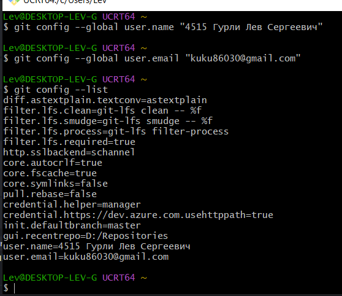
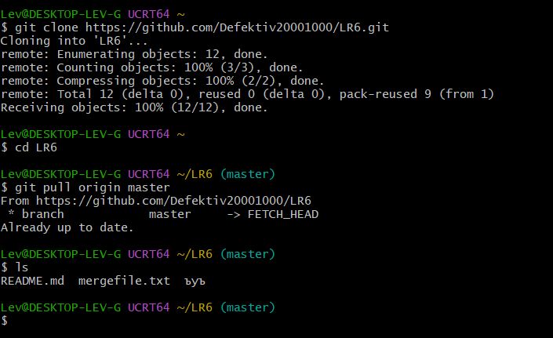
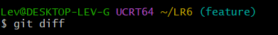
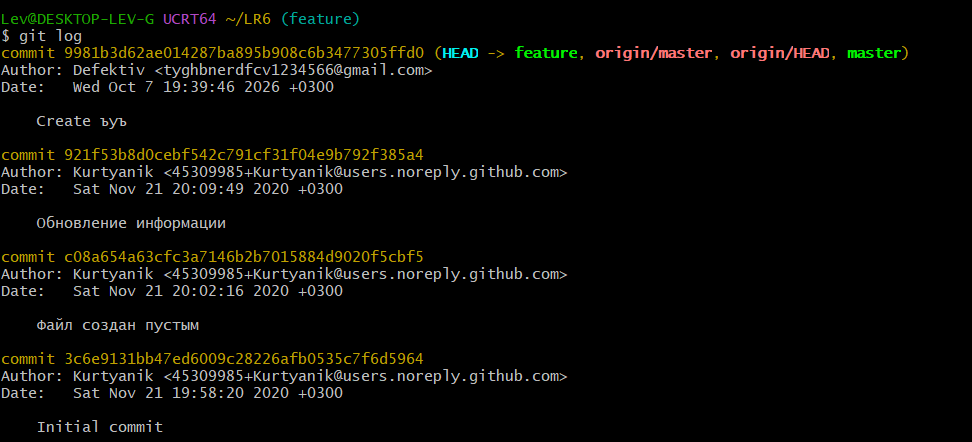
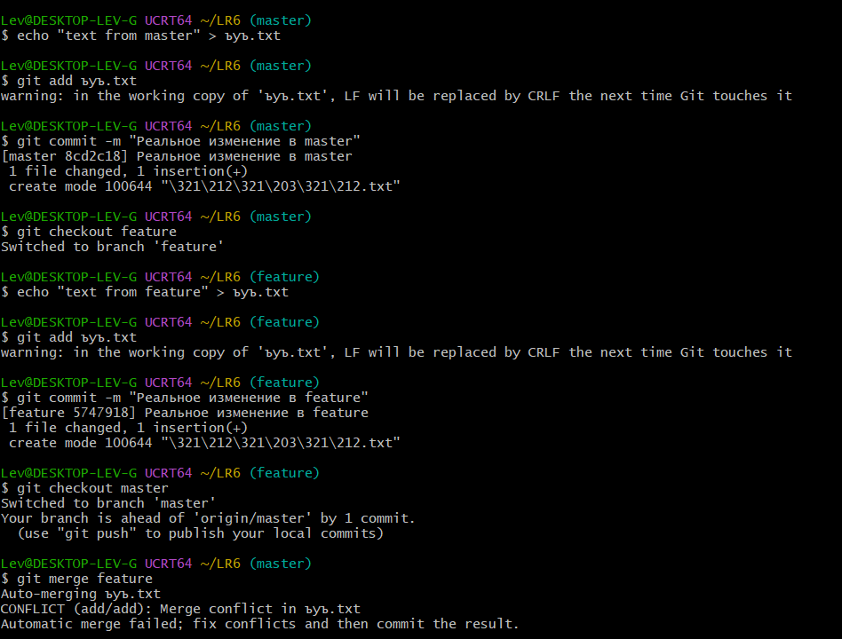
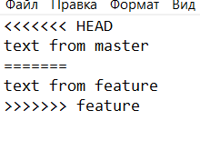
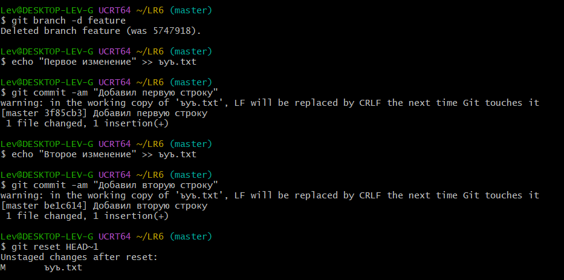
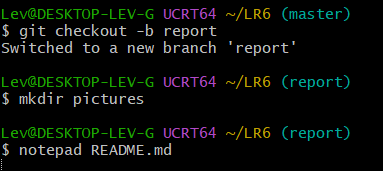
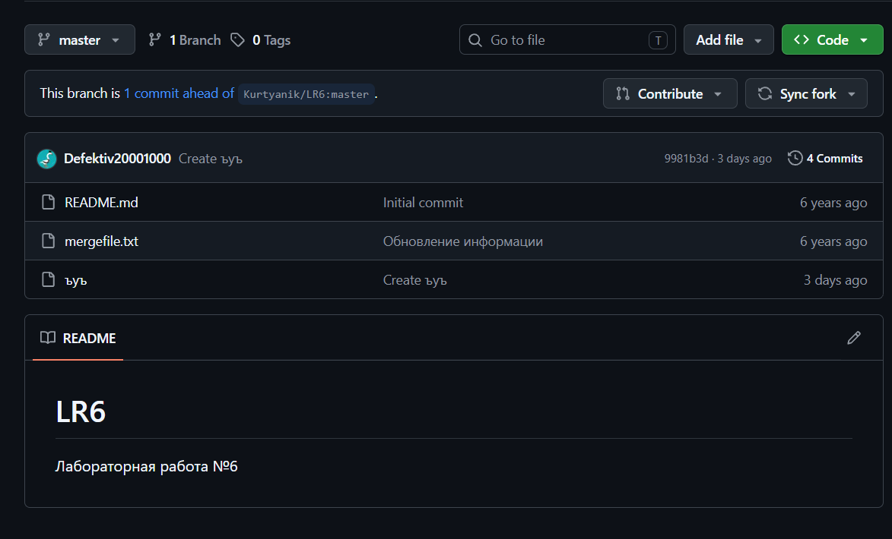

# Лабораторная работа №6: Система контроля версий

**Выполнил:** Студент группы 4515 Гурли Л.С.
**Преподаватель:** Старший преподаватель Мустафин Т.Р.
**Курс:** "Основы программирования"

## Цель работы:
Изучение базовых возможностей системы управления версиями, опыт работы с Git Api, опыт работы с локальным и удаленным репозиторием. 

## Ход работы:

### 1. Пункты 1-4.
Вошёл в аккаунт GitHub, создал копию репозитория LR6. Скачал и установил Git, заполнил поля в Git: Имя пользователя и почту.



Рисунок 1 - Заполнил свои данные

### 2. Пункты 5-8.
Клонировал удалённый репозиторий. Получил историю операций для каждой из веток, просмотрел последние изменения. Добавил файл через интерфейс GitHub. Подтянул изменения в локальный репозиторий. Получил историю операций для каждой из веток. Просмотрел последние изменения.



Рисунок 2.1 - Скопировал преподавательский репозиторий, собрал последние изменения из ветки master





Рисунки 2.2-2.3 - Отобразил изменения


### 3. Пункт 9.
Был искусственно вызван конфликт в файле ъуъ.txt при слиянии ветки feature в master. На рисунке 3.2 видно, что с ветки master поступил 1 текст, а с ветки feature 2 текст, в результате произошёл конфликт слияния, в ветку мастер не получается точно определить, что нужно записывать. Конфликт успешно разрешен вручную.



Рисунок 3.1 - Сохранил изменения в файле "ъуъ" через ветки feature и master, а потом произвёл объединение веток



Рисунок 3.2 - Зашёл вручную в редактор, удалил эффекты конфликта

### 4. Пункты 10-12
Удалена побочная ветка, сделаны изменения и зафиксированы несколько раз, оставлены комментарии. Сделан откат коммита.



### 5. Пункты 13-16.
Создана ветка для отчёта с наименованием report, в файле Readme пишется данный отчёт. В папке pictures будут сохранены все прилагающиеся скриншоты.





## Лог команд:
```text
4cc178e - 2026-10-11, 4515 Гурли Лев Сергеевич : Правки 2
ab1a259 - 2026-10-11, 4515 Гурли Лев Сергеевич : Добавил скриншоты и обновил отчет
3f85cb3 - 2026-10-10, 4515 Гурли Лев Сергеевич : Добавил первую строку
5f93174 - 2026-10-10, 4515 Гурли Лев Сергеевич : Conflict is resolved
5747918 - 2026-10-10, 4515 Гурли Лев Сергеевич : Реальное изменение в feature
8cd2c18 - 2026-10-10, 4515 Гурли Лев Сергеевич : Реальное изменение в master
9981b3d - 2026-10-07, Defektiv : Create ъуъ
921f53b - 2020-11-21, Kurtyanik : Обновление информации
c08a654 - 2020-11-21, Kurtyanik : Файл создан пустым
3c6e913 - 2020-11-21, Kurtyanik : Initial commit

```

## Вывод:
Изучил базовые возможности системы управления версиями, получил опыт работы с Git Api, опыт работы с локальным и удаленным репозиторием.


